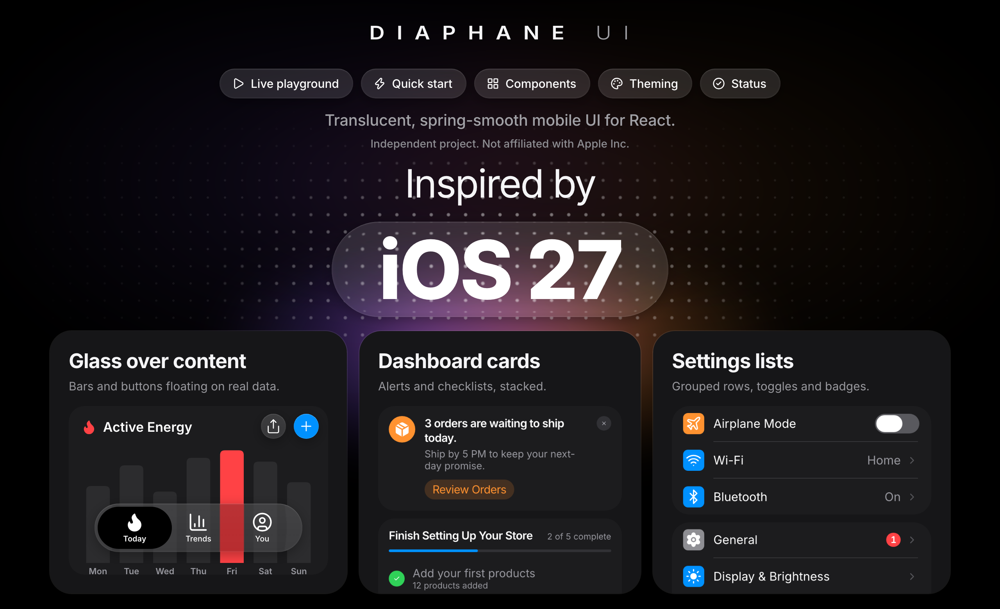
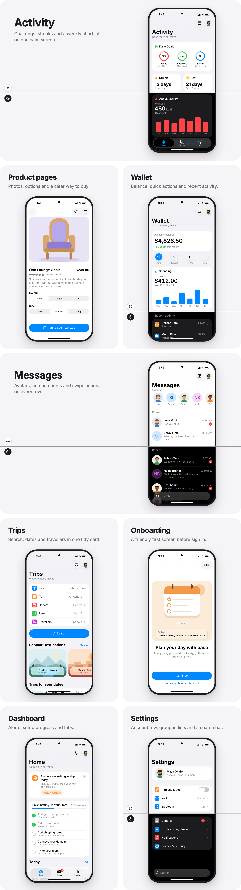

<h1 align="center">Diaphane UI: Inspired by iOS 27</h1>

<p align="center">
  <a href="https://github.com/sparecache/diaphane-ui/actions/workflows/ci.yml"></a>
  
  
  
  
  
  
  
  
</p>

<p align="center">
  
</p>

<p align="center">
  <a href="https://sparecache.github.io/diaphane-ui/">Playground</a> &nbsp;·&nbsp;
  <a href="#quick-start">Quick start</a> &nbsp;·&nbsp;
  <a href="#samples">Samples</a> &nbsp;·&nbsp;
  <a href="#components">Components</a> &nbsp;·&nbsp;
  <a href="#theming">Theming</a>
</p>

<p align="center">
  
</p>

A React library for **mobile-style interfaces on the web**: translucent glass, springy controls, draggable sheets and
screens that push and pop. Use it to prototype, present and, with the caveats under [Status](#status), ship.

- **48 components**, typed and documented, with light, dark, high contrast, RTL and 12 text sizes.
- **Props only**: no `className` or `style`, so screens stay consistent. No provider, no theme object.
- **Small**: about 39 KB of JavaScript and 25 KB of CSS, gzipped.
- **AI-readable**: [`catalog.json`](catalog.json) describes every component and when to use it.

*Inspired by iOS 27. Not affiliated with or endorsed by Apple Inc.* See the [disclaimer](#disclaimer).

## Quick start

```bash
npm install diaphane-ui react react-dom
```

```tsx
import { useState } from "react";
import Frame from "diaphane-ui/frame/phone";
import { Screen, NavigationBar, List, ListSection, ListItem } from "diaphane-ui";

export default function App() {
  const [wifi, setWifi] = useState(true);
  return (
    <Frame theme="dark">
      <Screen background="grouped" header={<NavigationBar title="Settings" />}>
        <List label="Settings">
          <ListSection header="Connectivity">
            <ListItem title="Wi‑Fi" icon="wifi" iconColor="blue" accessory="toggle" toggled={wifi} onToggle={setWifi} />
            <ListItem title="Bluetooth" icon="bluetooth" iconColor="blue" value="On" accessory="chevron" onPress={() => {}} />
          </ListSection>
        </List>
      </Screen>
    </Frame>
  );
}
```

`Frame` is optional. Without it, render inside any element marked `data-ds="diaphane"`.
To explore locally: `git clone https://github.com/sparecache/diaphane-ui.git && cd diaphane-ui && npm install && npm run dev`.

## Samples

Every image above is a live screen in the [playground](https://sparecache.github.io/diaphane-ui/), with light, dark,
RTL and text-size toggles. Single-component specimens are tucked under Components in its sidebar.

| Image | Open it |
|---|---|
| Activity | [Fitness](https://sparecache.github.io/diaphane-ui/?screen=flow-fitness) |
| Product page | [Shop](https://sparecache.github.io/diaphane-ui/?screen=flow-shop), then open a product |
| Wallet | [Banking](https://sparecache.github.io/diaphane-ui/?screen=flow-banking) |
| Messages | [Messaging](https://sparecache.github.io/diaphane-ui/?screen=flow-messages) |
| Trips | [Travel](https://sparecache.github.io/diaphane-ui/?screen=flow-travel) |
| Onboarding | [Onboarding](https://sparecache.github.io/diaphane-ui/?screen=flow-onboarding) |
| Dashboard cards | [Dashboard](https://sparecache.github.io/diaphane-ui/?screen=flow-dashboard) |
| Settings lists | [Settings](https://sparecache.github.io/diaphane-ui/?screen=flow-settings) |
| Glass over content | [Glass close-up](https://sparecache.github.io/diaphane-ui/closeups.html?shot=hero-glass) |

## Components

| Area | Components |
|---|---|
| Layout | `Form` `List` `ListItem` `ListSection` `Screen` `SectionHeader` `Stack` |
| Navigation | `NavigationBar` `NavigationStack` `PageControl` `TabBar` |
| Actions | `Button` `IconButton` `Toolbar` |
| Inputs | `Checkbox` `DatePicker` `Picker` `SearchField` `SegmentedControl` `Slider` `Stepper` `TextField` `Toggle` |
| Display | `Avatar` `Badge` `Card` `Chart` `Checklist` `Gauge` `Glass` `Icon` `Media` `NotificationCard` `Rating` `RatingSummary` `StatCard` `Text` |
| Feedback | `Banner` `EmptyState` `ErrorState` `FieldError` `FieldHint` `ProgressView` |
| Overlays | `ActionSheet` `Alert` `ContextMenu` `Menu` `Sheet` |

Props, `use` and `avoid` guidance and accessibility notes for each are in [`catalog.json`](catalog.json).

## Theming

Every colour, radius and duration is a CSS variable:

```css
[data-ds="diaphane"] { --dph-accent: #5e5ce6; }
```

| Mode | Prop on `Frame` | Attribute on any wrapper |
|---|---|---|
| Light / dark | `theme="light \| dark"` | `data-theme` |
| High contrast (WCAG AA) | `contrast="high"` | `data-contrast="high"` |
| Right-to-left | `dir="rtl"` | `dir="rtl"` |
| Text size (12 steps) | `textSize="AX3"` | `data-text-size` |

Icons are built on [Lucide](https://lucide.dev) (ISC); add your own with `registerIcons`. The font stack uses the
device's system font, with the open font [Inter](https://rsms.me/inter/) (SIL OFL 1.1) as the fallback.

## Status

Version **0.x**: APIs may change before 1.0, so pin your version. 23 automated checks and a CI build cover structure,
catalog, contrast, scoping and icons; there is no unit or visual-regression suite yet. It is verified in Chromium only
and ships as TypeScript and CSS source, so you need a bundler. The default palette trades some contrast for the soft
look; `contrast="high"` passes WCAG AA everywhere. It is ready for prototypes, demos, design reviews and internal tools.
For customer-facing apps, audit the screens you ship.

## Repository

| Path | What |
|---|---|
| [`src/`](src) | Components, tokens and icons |
| [`frame/`](frame) | Generic phone frame |
| [`examples/`](examples) | Reference screens and sample flows |
| [`playground/`](playground) | `npm run dev`: every screen, plus the glass close-ups |
| [`docs/`](docs) | Design notes, conventions, catalog sources and the README images |

`npm run check` runs typecheck, validation and the licence audit. See [CONTRIBUTING.md](CONTRIBUTING.md): work must be
original or open-licensed and must not include files, icons, fonts or text copied from any vendor's operating system,
SDK or design kit.

## Disclaimer

Diaphane UI is an independent open-source project, inspired by iOS 27 and not affiliated with, authorized, sponsored or
endorsed by Apple Inc. It contains no Apple software, fonts, icons, images or documentation; the phone frame is a
generic shape. iOS, iPhone, iPad, SF Symbols and other Apple names are trademarks of Apple Inc., registered in the U.S.
and other countries. iOS is a trademark or registered trademark of Cisco in the U.S. and other countries and is used
under license. They are mentioned only to describe the design this project draws inspiration from. See
[THIRD_PARTY_NOTICES.md](THIRD_PARTY_NOTICES.md). This is a plain-language summary, not legal advice.

## License

[MIT](LICENSE) © 2026 sparecache.
